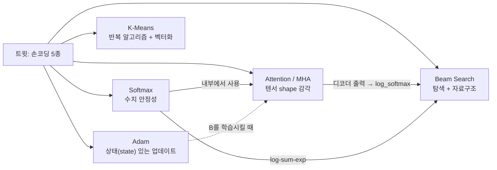
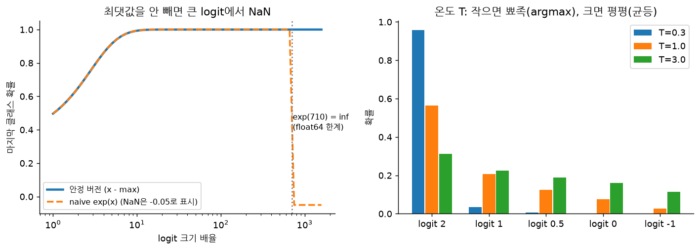
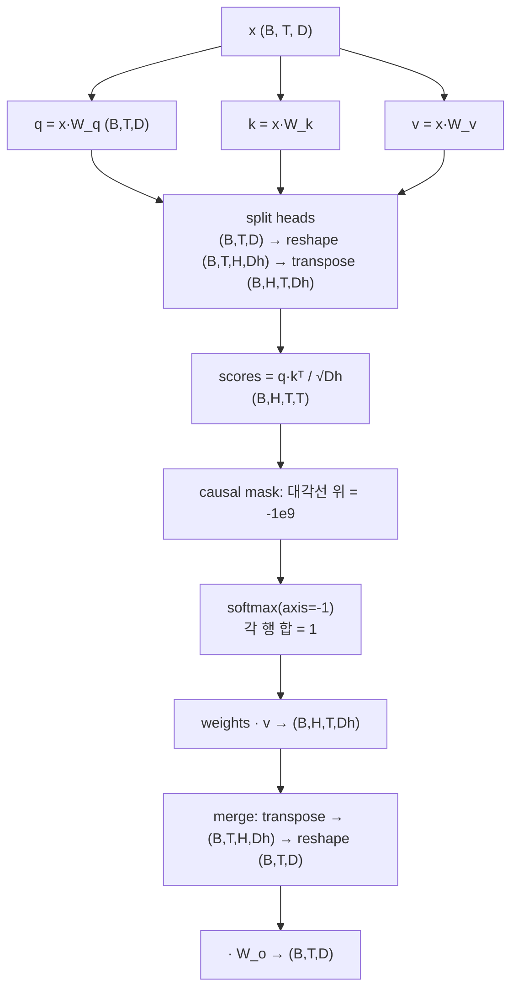
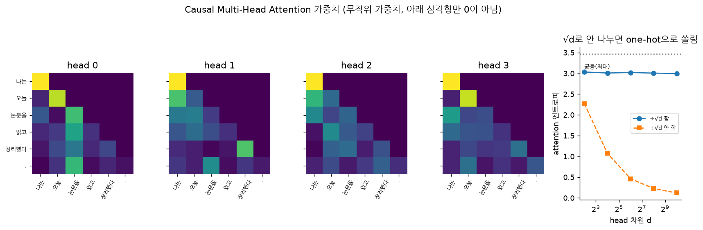
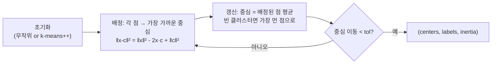
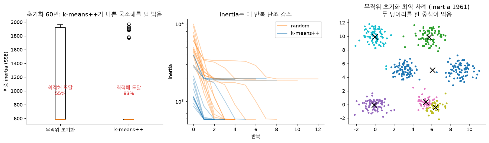
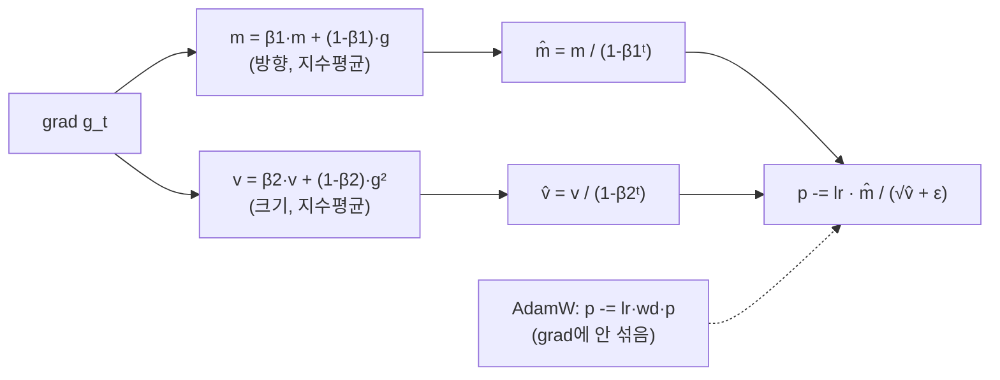
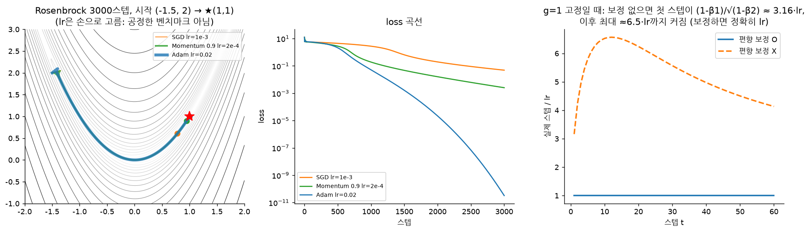
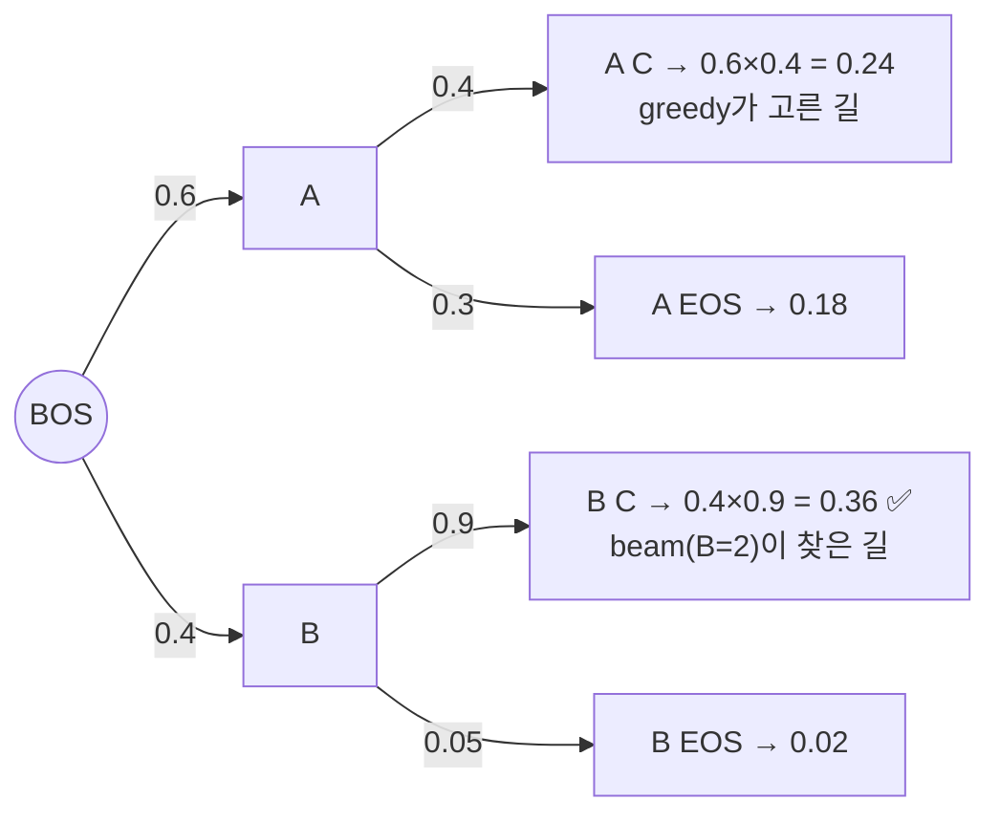
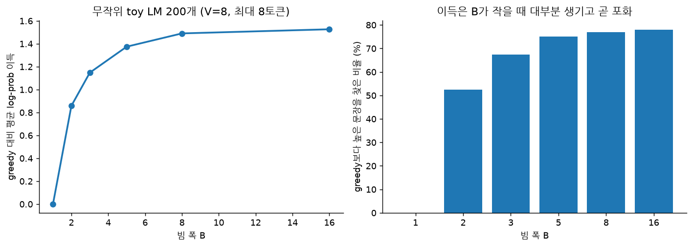

# ml-interview-handwrite — AI 면접 손코딩 5종 공부 레포

> 출발점: [@Zen_with_AI 트윗](https://x.com/Zen_with_AI/status/2114772797889409274) (2026-10-27 02:35 KST)
> "AI 직무 면접에서 손으로 능숙하게 써야 하는 알고리즘 5개: **Softmax, Attention(Multi-Head 포함), K-Means, Adam, Beam Search**. 면접 전에 종이에 먼저 연습해 두라."

이 레포는 그 5개를 **NumPy만으로** 직접 짜고, **PyTorch / scikit-learn / 완전탐색과 숫자를 맞춰 보는 테스트**로 검증하고, 빈칸 템플릿으로 **종이 → 코드 → 자동 채점** 연습을 할 수 있게 만든 공부 레포입니다.

라벨 규칙: **[확인한 사실]** 이 레포의 테스트·차트로 직접 돌려 확인했거나 원 논문에 있는 내용 · **[주장]** 트윗 작성자 등 남의 말 · **[추론]** 내 해석

---

## 0. 트윗을 어떻게 읽을까

| 항목 | 내용 | 라벨 |
|---|---|---|
| 작성자 | 山景城小路 (@Zen_with_AI), 소개란: 실리콘밸리 현업 AI 아키텍트, 면접 코칭 | [확인한 사실] 프로필 문구. 경력 자체는 [주장] |
| 핵심 문장 | "면접에서 이 5개는 손코딩 필수" | [주장] 근거·통계 없음, 한 사람의 경험담 |
| 반응 | 조회 16,812 · 좋아요 355 · **북마크 373** · RT 42 (2026-10-27 10:10 KST 확인) | [확인한 사실] 북마크 > 좋아요 → "저장해 두고 연습할 목록"으로 소비됨 |
| 링크·논문 | 없음. 본문 6줄이 전부 | [확인한 사실] |

**[추론]** 5개는 성격이 다 다르다. 그래서 "면접관이 무엇을 보는가"가 각각 다르다.



---

## 1. 빠른 시작

```bash
python -m venv .venv && source .venv/bin/activate
pip install -r requirements.txt          # numpy, matplotlib, pytest (+ 선택: torch CPU, scikit-learn)
pytest -q                                # 정답 구현 검증: 14 passed
python -m handwrite.attention            # 각 파일은 단독 실행 데모가 있음
python charts/make_charts.py             # README 그림 다시 만들기

# 연습 모드: blank/ 의 빈칸을 채운 뒤 내 코드를 채점
IMPL=blank pytest -q -k softmax
```

torch·sklearn이 없으면 그 대조 테스트만 건너뜁니다. **[확인한 사실]** CPU 박스에서 NumPy 2.5 / torch 2.14(CPU) / scikit-learn 1.9 기준 14개 전부 통과, 약 3초.

```
ml-interview-handwrite/
├── handwrite/        # 정답 구현 (각 30~80줄, NumPy만)
│   ├── softmax.py  attention.py  kmeans.py  adam.py  beam_search.py
├── blank/            # 같은 시그니처의 빈칸 → 종이에 쓴 걸 옮겨서 채점
├── tests/            # torch / sklearn / 완전탐색 대조 테스트 (IMPL 환경변수로 대상 선택)
├── charts/           # make_charts.py + PNG 5장
├── EXERCISES.md      # 종이 연습 순서, 꼬리 질문, 자가 점검표
└── requirements.txt
```

---

## 2. Softmax — "최댓값 빼기" 한 줄이 전부다

$$\mathrm{softmax}(x)_i=\frac{e^{x_i}}{\sum_j e^{x_j}}=\frac{e^{x_i-c}}{\sum_j e^{x_j-c}}\quad(c=\max x)$$

- **[확인한 사실]** 분자·분모에 같은 $e^{-c}$가 곱해지므로 결과는 같다 (`test_softmax_shift_invariance`).
- **[확인한 사실]** float64에서 `exp(710)`은 inf → inf/inf = NaN. 아래 왼쪽 그림에서 naive 버전은 배율 ≈ 710에서 무너진다. float16이면 `exp(x)`가 65504를 넘는 x≈11.09에서 터진다.
- **[확인한 사실]** backward는 야코비안 $\mathrm{diag}(y)-yy^\top$를 행렬로 만들 필요 없이 `y * (dy - sum(dy*y))` 한 줄. torch autograd와 일치 (`test_softmax_backward_matches_autograd`).
- 온도 T: logit을 T로 나눔. T→0이면 argmax, T→∞이면 균등.



**면접 꼬리 질문** → [EXERCISES.md](EXERCISES.md#1-softmax)

---

## 3. Attention + Multi-Head — shape를 말로 설명할 수 있으면 끝

$$\mathrm{Attention}(Q,K,V)=\mathrm{softmax}\!\left(\frac{QK^\top}{\sqrt{d_k}}+M\right)V$$



- **[확인한 사실]** `scaled_dot_product_attention`은 `torch.nn.functional.scaled_dot_product_attention(is_causal=True)`와 1e-10 안에서 일치, `MultiHeadAttention`은 가중치를 옮겨 넣은 `torch.nn.MultiheadAttention`과 일치 (`test_mha_matches_torch_module`). torch는 `x @ Wᵀ` 규약이라 전치해서 넣어야 맞는다 — 실제로 틀리기 쉬운 지점.
- **[확인한 사실]** $\sqrt{d}$로 나누는 이유: q·k 성분이 평균 0·분산 1이면 내적의 분산은 $d$. 안 나누면 d가 클수록 softmax가 one-hot으로 쏠린다(그래디언트 소실). 오른쪽 그래프: d=1024에서 엔트로피 3.0(나눔) vs 0.1 근처(안 나눔). 원 논문 Vaswani et al. 2017 §3.2.1의 설명과 같다.
- **[추론]** 마스크를 `-inf` 대신 `-1e9`로 두면, 한 행 전체가 가려지는 경우(패딩)에도 NaN이 안 난다. 면접에서 "왜 -inf 안 썼냐"는 질문에 이 답이 좋다.
- **[추론]** 면접관이 보는 건 수식이 아니라 `reshape`와 `transpose` 순서. `(B,T,D)`를 바로 `(B,H,T,Dh)`로 reshape하면 **에러 없이 틀린 값**이 나온다.



---

## 4. K-Means — 두 단계 반복 + 초기화가 승부



- **[확인한 사실]** 배정·갱신 두 단계 모두 inertia(SSE)를 늘리지 않는다 → 단조 감소, 유한 번 안에 멈춤 (`test_kmeans_inertia_monotone`). 하지만 **전역 최적은 보장 안 됨**.
- **[확인한 사실]** 6개 덩어리 데이터에서 초기화 60번: 최적해(최소 inertia의 1% 이내) 도달 비율 무작위 **55%** vs k-means++ **83%** (아래 왼쪽). k-means++(Arthur & Vassilvitskii 2007)는 이미 뽑힌 중심에서 먼 점일수록 $D(x)^2$ 비율로 뽑는다.
- **[확인한 사실]** 10번 재시작 중 최선 inertia가 `sklearn.cluster.KMeans(n_init=10)`와 0.1% 안에서 같다 (`test_kmeans_close_to_sklearn`).
- **[추론]** 이 데이터 한 종류·60번 실험이라 55/83%는 "방향"만 보여 준다. 비율 자체를 일반화하면 안 된다.



---

## 5. Adam — 상태 두 개(m, v)와 편향 보정



- **[확인한 사실]** `Adam`(L2를 grad에 더함)과 `AdamW`(decoupled) 둘 다 `torch.optim.Adam` / `torch.optim.AdamW`와 50스텝 궤적이 1e-10 안에서 일치 (`test_adam_matches_torch`, 3가지 설정).
- **[확인한 사실]** 편향 보정이 왜 필요한가: m, v가 0에서 시작해서 초반 값이 작게 나온다. 그래디언트가 항상 1이면 보정 없을 때 첫 스텝이 $(1-\beta_1)/\sqrt{1-\beta_2}\approx 3.16\cdot lr$, 이후 최대 ≈ 6.5·lr까지 커진다. 보정하면 정확히 lr (오른쪽 그림). Kingma & Ba 2014 §3.
- **[확인한 사실]** Rosenbrock 3000스텝: Adam(lr 0.02)이 loss 1e-10대, SGD/Momentum은 1e-2~1e-3대. **단, lr은 내가 손으로 고른 값이라 공정한 비교가 아니다.** SGD도 lr 2e-3이면 1e-5까지 간다.
- **[추론]** AdamW가 표준이 된 이유를 한 줄로: Adam에서 L2를 grad에 섞으면 $\sqrt{\hat v}$로 나눠지면서 파라미터마다 감쇠 세기가 달라진다 → 의도한 weight decay가 아니다 (Loshchilov & Hutter 2019).



---

## 6. Beam Search — greedy의 근시안을 조금만 고친다

교과서 예 (`classic_example`): greedy는 첫 토큰 확률 0.6짜리 A를 고르지만, 0.4짜리 B 뒤에 0.9가 오면 전체 확률은 B 쪽이 더 높다.



- 매 스텝: 살아 있는 빔 B개 × 어휘 V → 후보 중 상위 B개만 남김. **확률 곱 대신 log-prob 합** (underflow 방지).
- **[확인한 사실]** 빔당 후보를 B개가 아니라 **2B개** 본다. 상위 후보 일부가 EOS로 빠져 나가도 살아 있는 빔 B개를 채우기 위해서다 (Hugging Face `generate`도 2B를 씀).
- **[확인한 사실]** 빔 폭을 $V^L$로 키우면 완전탐색 최적해와 정확히 같고 (`test_wide_beam_equals_brute_force`), 폭 1이면 greedy와 같다.
- **[확인한 사실]** 무작위 toy LM 200개에서 greedy보다 높은 문장을 찾은 비율: B=2 52.5%, B=3 67.5%, B=5 75%, B=16 78%. 이득은 작은 B에서 대부분 생기고 곧 포화 (아래).
- **[추론]** 길이 패널티 `score / len^α`가 없으면 짧은 문장을 편애한다(log-prob은 더할수록 작아지니까). 또 번역·요약에선 빔이 도움이 되지만 대화형 LLM에선 반복·밋밋함 때문에 top-p 샘플링을 주로 쓴다 — 면접에서 "왜 ChatGPT는 빔 안 쓰냐" 질문 대비.



---

## 7. 핵심 정리 (5줄)

1. **[주장]** 트윗은 5개를 "AI 면접 손코딩 필수"라 했지만 근거는 작성자 경험뿐이다. 북마크(373)가 좋아요(355)보다 많아 "연습 목록"으로 저장됐다.
2. **[확인한 사실]** 5개 모두 NumPy 30~80줄이면 되고, torch·sklearn 결과와 1e-10 수준으로 맞출 수 있다 (14 tests).
3. **[확인한 사실]** 각 알고리즘의 "함정 한 줄"이 따로 있다: softmax의 `-max`, attention의 `transpose 후 reshape`·`√d`, k-means의 빈 클러스터·초기화, Adam의 편향 보정·decoupled wd, beam의 `2B` 후보·log-prob 합.
4. **[추론]** 면접관은 정답 코드보다 이 함정을 **먼저 말로** 짚는지를 본다. 종이 연습 때 코드 옆에 shape·이유를 주석으로 쓰는 습관이 핵심.
5. **[추론]** 목록에서 빠진 단골도 있다: cross-entropy(+softmax 결합 그래디언트 `p - y`), LayerNorm/RMSNorm, top-k/top-p 샘플링, KV cache, RoPE, 2층 MLP 역전파. → [EXERCISES.md](EXERCISES.md#보너스-목록에-없지만-자주-나오는-것)

---

## 출처

- 트윗: https://x.com/Zen_with_AI/status/2114772797889409274 (fxtwitter API로 읽음: `api.fxtwitter.com`)
- Vaswani et al., *Attention Is All You Need*, 2017 — https://arxiv.org/abs/1706.03762
- Kingma & Ba, *Adam: A Method for Stochastic Optimization*, 2014 — https://arxiv.org/abs/1412.6980
- Loshchilov & Hutter, *Decoupled Weight Decay Regularization* (AdamW), 2019 — https://arxiv.org/abs/1711.05101
- Arthur & Vassilvitskii, *k-means++: The Advantages of Careful Seeding*, SODA 2007 — https://theory.stanford.edu/~sergei/papers/kMeansPP-soda.pdf
- PyTorch `scaled_dot_product_attention` / `MultiheadAttention` / `optim.Adam(W)` 문서 — https://pytorch.org/docs/stable/
- Hugging Face Transformers 생성 전략 (beam search) — https://huggingface.co/docs/transformers/generation_strategies

라이선스: MIT
